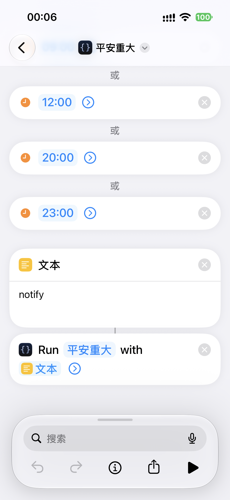
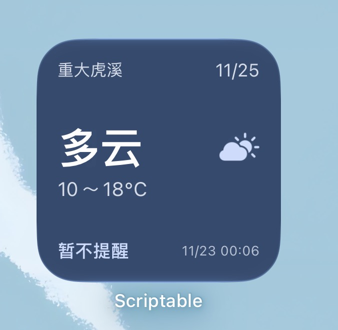

<div align="center">
  <h1>重庆大学晴天预约提醒</h1>
  <p>提前两天看天气，晴天时提醒预约。</p>
  <p><a href="#iphone-使用教程">iPhone 教程</a> · <a href="#安卓使用教程">安卓教程</a> · <a href="#验证定时通知">验证通知</a> · <a href="https://mobilereserve.cqu.edu.cn/#/login">预约入口</a></p>
</div>

本项目由 **awesome-sean** 整理维护，提供重庆大学天气预约提醒脚本，以及 iPhone、安卓两套配置教程。安卓端运行环境为独立项目 **[Scriptable Android](https://github.com/awesome-sean/scriptable-android)**；它基于 [EdenleeGitHub/scriptable-android](https://github.com/EdenleeGitHub/scriptable-android) 派生。本仓库专门存放天气脚本和教程，不是 APK 源码仓库。

## 它会做什么

在每天设定的时间，检查**北京时间后天的白天天气**；预报严格为 **“晴”** 时，发送预约提醒。点击通知可进入预约网页，由你自行完成预约。

例如：**11 月 22 日运行 → 检查 11 月 24 日天气 → 晴天时提醒预约 24 日。**

- 使用 UAPI 的**重庆市沙坪坝区**预报，地区代码 `500106`，不是校园独立气象观测。
- 判断的是后天这一天，不是未来两天中任意一天；“晴转雨”“多云转晴”等不算“晴”。
- 非晴天不发预约通知；接口失败会记录原因，不用缓存或示例天气代替实际预报。
- 同一天安排多个执行时间，符合条件时每次都会提醒。
- 桌面小组件可选，预览和桌面刷新不会触发预约通知。

本项目只做提醒，不自动登录、提交预约或保证预约成功；可预约日期与开放时间以学校预约页面为准。

## 先选你的手机

| 手机 | 需要安装 | 天气脚本 | 定时方式 |
| --- | --- | --- | --- |
| iPhone | [Scriptable](https://scriptable.app/) + 系统“快捷指令” | [查看 JS](scripts/ios/cqu-weather.js) / [复制代码 TXT](scripts/ios/cqu-weather.txt) | 快捷指令个人自动化 |
| 安卓 | [Scriptable Android 项目](https://github.com/awesome-sean/scriptable-android) / [下载 APK](https://github.com/awesome-sean/scriptable-android/releases/latest) | [下载安卓 JS](https://raw.githubusercontent.com/awesome-sean/cqu-sunny-reservation/main/scripts/android/cqu-weather.js) | 应用内“自动化” |

下载整个项目：点本页 **Code → Download ZIP**，解压后按对应平台使用。两端天气逻辑相同，安装方式分别见下文。

## iPhone 使用教程

### 1. 安装并导入脚本

1. 在 App Store 搜索并安装 **Scriptable**。
2. 打开 [iPhone 代码 TXT](scripts/ios/cqu-weather.txt)，点 **Raw / 原始文件**，全选并复制代码。
3. 打开 Scriptable，点 **＋** 新建脚本，粘贴全部代码。
4. 将脚本命名为 **重大天气提醒**，保存后点 **▶** 运行。
5. 首次按提示允许联网与通知；正常情况下可看到天气小组件预览。

手动运行出现预览是正常的；预约通知需要下面的 `notify` 模式。

### 2. 创建用于通知的快捷指令

1. 打开苹果“快捷指令”，新建一个快捷指令，命名为 **重大天气提醒**。
2. 添加 **“文本”** 操作，文本内容只填下面这一行：

   ```text
   notify
   ```

3. 再添加 **Scriptable → Run Script（运行脚本）** 操作，选择 Scriptable 中的 **重大天气提醒**。
4. 将它的 **Parameter（参数）** 设为上一步“文本”操作的输出：点或长按参数位置，选择变量，再选择前面的“文本”结果。
5. 展开操作选项，将 **Run In App** 和 **运行时显示** 关闭（如有这些选项）。
6. 点运行，首次允许所需权限。后天不是晴天时，不收到预约通知是正常的。

操作顺序应为：

```text
文本：notify
    ↓
Scriptable：运行“重大天气提醒”
参数：前面“文本”的输出
```

如果点 Parameter 后跳到文件选择器，返回即可；这里传的是文本变量，不需要选择文件。“Texts / URLs / Images / Files”等额外输入项无需填写。只出现 Run Script 的完成勾号，也不代表已发送通知；是否发送取决于天气判断。

参数通过 Scriptable 的 [args.shortcutParameter](https://docs.scriptable.app/args/#shortcutparameter) 传给脚本。

<p align="center"></p>

图中“文本”填写 `notify`，下方 Run Script 的参数选择“文本”变量。截图中的“平安重大”是自定义名称；按本教程配置时选择你自己的“重大天气提醒”。图中时间仅为示例，可按需要设置。

### 3. 设置每天定时执行

1. 打开“快捷指令”→ **自动化 → ＋**，创建个人自动化。
2. 选择 **特定时间**，设置想检查的时间，重复选 **每天**。
3. 选择 **立即运行**；旧界面如显示“运行前询问”，将其关闭。
4. 选择刚创建的 **重大天气提醒** 快捷指令；如进入空白编辑页，添加“运行快捷指令”，再选它。
5. 保存。若快捷指令的隐私选项中有 **允许锁定时运行**，将其开启。

需要每天多个时间，可分别创建自动化并调用同一个快捷指令。触发时间按手机系统时区安排；脚本检查的“后天”始终按北京时间计算。不同 iOS 版本的按钮名称可能略有不同，可参考 [Apple 个人自动化说明](https://support.apple.com/zh-cn/guide/shortcuts/apd690170742/ios)。

### 4. 添加桌面小组件（可选）

1. 长按桌面空白处，进入 **编辑 → 添加小组件**（部分版本显示“＋”）。
2. 搜索 Scriptable，选择最小的正方形组件并添加。
3. 长按组件 → 编辑小组件，Script 选 **重大天气提醒**，Parameter 留空。

小组件刷新由系统安排，不能用它代替第三步的定时自动化。

<p align="center"></p>

图中为小组件展示示例，“多云／暂不提醒”表示本次未达到晴天提醒条件。截图使用了旧的地点名称“重大虎溪”，本仓库脚本显示为“重庆大学”；日期、天气和温度以实际查询结果为准。

## 安卓使用教程

### 1. 下载应用与脚本

1. 打开 **[Scriptable Android 下载页](https://github.com/awesome-sean/scriptable-android/releases/latest)**，下载 `Scriptable-Android-版本号.apk`。
2. 打开 APK，按系统提示允许安装。支持 Android 8.0 及以上。
3. 下载 [安卓天气脚本 cqu-weather.js](https://raw.githubusercontent.com/awesome-sean/cqu-sunny-reservation/main/scripts/android/cqu-weather.js)。
4. 打开应用，点脚本页搜索框右侧的 **导入按钮（向下箭头）**，选择该 JS 文件。
5. 导入后打开脚本，点 **运行**，确认能显示天气预览。脚本在应用中显示为文件名时，可通过脚本菜单将其改名为 **重大天气提醒**。

天气脚本需要单独导入，未打包进 APK 的内置示例。应用安装、版本更新与源码说明请看 **[APK 项目 README](https://github.com/awesome-sean/scriptable-android#readme)**。

### 2. 先完成运行设置

点底栏 **自动化**，按页首“先完成运行设置”的说明操作：

- **通知**：允许应用发送通知；需要横幅、声音时，在系统通知设置中开启。
- **精确定时**：允许应用按设定时间触发任务。
- **后台运行**：按手机系统要求开启自启动、允许后台运行，并检查电池限制。

此脚本使用固定地区，不需要定位权限。不同品牌的后台设置名称不同，以手机实际页面为准。

### 3. 新建每天的天气提醒

点 **新建**，按下表填写：

| 项目 | 填写内容 |
| --- | --- |
| 名称 | 重大天气提醒 |
| 执行脚本 | 选择刚导入的安卓天气脚本 |
| 每天运行时间 | 例如 `09:00`；多个时间可填 `09:00,18:00` |
| 时区 | `Asia/Shanghai` |
| 脚本参数 | `notify` |
| 启用定时执行 | 打开 |

点 **保存**，确认显示的“下次”时间正确。可以返回桌面或锁屏等待，不要强行停止应用。可点“运行一次”检查脚本，然后查看任务的“结果”。

后天不是晴天时不发预约通知，属于正常情况。“已完成”只表示脚本执行结束，不代表一定发送通知。

### 4. 添加桌面小组件（可选）

1. 运行天气脚本，生成小组件预览。
2. 使用预览中的添加入口；也可长按桌面空白处 → 小组件，选择 Scriptable Android。
3. 选择天气脚本，内容尺寸选 **小 · 默认**，参数留空，保存。
4. 默认申请 **2×2**；最终占位由手机桌面决定，必要时长按调整大小。

小组件只展示天气与预约入口。通知由第三步的自动化触发，两者分别设置。

## 验证定时通知

不想等晴天，可以使用 [通知测试脚本](scripts/common/test-notification.js)。它不联网、不判断天气，每次执行都提交一条测试通知。

1. **先手动测试**：安卓导入 JS 后运行；iPhone 将 [测试代码 TXT](scripts/common/test-notification.txt) 复制到一个新脚本中运行。允许通知，确认能收到“定时通知测试成功”。
2. **再测试定时**：安卓新建自动化并选择测试脚本，参数留空；iPhone 新建一个快捷指令，添加 Scriptable 的 Run Script 并选择测试脚本，再为它创建个人自动化。
3. 将触发时间设为 **当前时间之后 3～5 分钟**，保存后返回桌面等待，核对通知中的实际执行时间。
4. 测完关闭或删除这个测试自动化，避免每天重复提醒。

“运行一次”只验证立即执行；等到设定时间触发，才能验证定时链路。测试成功不代表天气接口也一定正常，正式天气任务仍需检查联网结果。

## 常见问题

| 情况 | 检查方法 |
| --- | --- |
| 天气脚本运行了，却没有通知 | 查看后天白天天气是否严格为“晴”，以及自动化参数是否为 `notify`。 |
| 手动测试也没有通知 | 检查 Scriptable / Scriptable Android 的通知权限、通知渠道和勿扰模式。 |
| 手动正常，定时没收到 | iPhone 检查自动化是否“立即运行”；安卓检查精确定时、自启动、后台及省电设置。 |
| 有通知，但没有横幅或声音 | 检查系统通知样式、声音与勿扰设置。 |
| 小组件有天气，却没有预约提醒 | 小组件不会发通知，需要另外配置定时自动化。 |
| 小组件显示“未更新”或脚本报请求失败 | 检查网络与接口是否正常，重新运行查看错误；不会显示伪造天气。 |
| iPhone 的参数位置打开了文件选择器 | 改为选择前面“文本”操作的输出变量，不要选择文件。 |

系统调度、省电与网络状况可能导致延迟。本项目不保证所有手机都准点弹出横幅；建议先用测试脚本核对自己的设备。

## 项目关系与参考

- **本仓库**：天气预约脚本与双平台教程，由 awesome-sean 整理维护。
- **安卓运行环境**：[awesome-sean/scriptable-android](https://github.com/awesome-sean/scriptable-android)，基于 [EdenleeGitHub/scriptable-android](https://github.com/EdenleeGitHub/scriptable-android) 派生，保留其原有许可。
- **iPhone 运行环境**：[Scriptable](https://scriptable.app/)，API 参考 [Scriptable 文档](https://docs.scriptable.app/)。
- **预约入口**：[重庆大学预约页面](https://mobilereserve.cqu.edu.cn/#/login)。
- **本仓库许可**：[MIT](LICENSE)；不包含以上应用的源码或 APK，运行环境各自的许可仍然适用。

本项目与重庆大学、Scriptable、Apple 及天气服务提供方没有官方隶属或合作关系。
