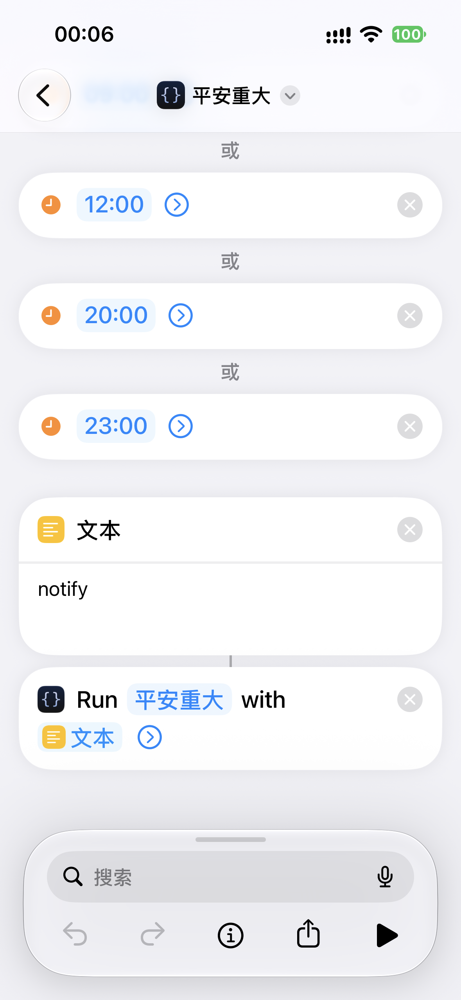
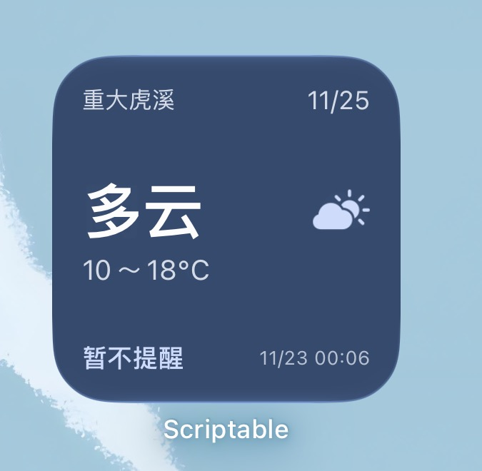

## 1. 安装并导入脚本

1. 在 App Store 搜索并安装 **Scriptable**。
2. 点上方 **复制 iPhone 代码**；也可打开 [代码 TXT](/downloads/cqu-weather-ios.txt)，全选并复制。
3. 打开 Scriptable，点 **＋** 新建脚本，粘贴全部代码。
4. 将脚本命名为 **重大天气提醒**，保存后点 **▶** 运行。
5. 首次按提示允许联网与通知；正常情况下可看到天气小组件预览。

手动运行出现预览是正常的；预约通知需要下面的 `notify` 模式。

## 2. 创建用于通知的快捷指令

1. 打开苹果“快捷指令”，新建一个快捷指令，命名为 **重大天气提醒**。
2. 添加 **“文本”** 操作，文本内容只填下面这一行：

   ```text
   notify
   ```

3. 再添加 **Scriptable → Run Script（运行脚本）** 操作，选择 Scriptable 中的 **重大天气提醒**。
4. 将它的 **Parameter（参数）** 设为上一步“文本”操作的输出：点或长按参数位置，选择变量，再选择前面的“文本”结果。
5. 展开操作选项，将 **Run In App** 和 **运行时显示** 关闭（如有这些选项）。
6. 点运行，首次允许所需权限。后天不是晴天时，不收到预约通知是正常的。

操作顺序应为：

```text
文本：notify
    ↓
Scriptable：运行“重大天气提醒”
参数：前面“文本”的输出
```

如果点 Parameter 后跳到文件选择器，返回即可；这里传的是文本变量，不需要选择文件。“Texts / URLs / Images / Files”等额外输入项无需填写。只出现 Run Script 的完成勾号，也不代表已发送通知；是否发送取决于天气判断。

参数通过 Scriptable 的 [args.shortcutParameter](https://docs.scriptable.app/args/#shortcutparameter) 传给脚本。

<p align="center"></p>

图中“文本”填写 `notify`，下方 Run Script 的参数选择“文本”变量。截图中的“平安重大”是自定义名称；按本教程配置时选择你自己的“重大天气提醒”。图中时间仅为示例，可按需要设置。

## 3. 设置每天定时执行

1. 打开“快捷指令”→ **自动化 → ＋**，创建个人自动化。
2. 选择 **特定时间**，设置想检查的时间，重复选 **每天**。
3. 选择 **立即运行**；旧界面如显示“运行前询问”，将其关闭。
4. 选择刚创建的 **重大天气提醒** 快捷指令；如进入空白编辑页，添加“运行快捷指令”，再选它。
5. 保存。若快捷指令的隐私选项中有 **允许锁定时运行**，将其开启。

需要每天多个时间，可分别创建自动化并调用同一个快捷指令。触发时间按手机系统时区安排；脚本检查的“后天”始终按北京时间计算。不同 iOS 版本的按钮名称可能略有不同，可参考 [Apple 个人自动化说明](https://support.apple.com/zh-cn/guide/shortcuts/apd690170742/ios)。

## 4. 添加桌面小组件（可选）

1. 长按桌面空白处，进入 **编辑 → 添加小组件**（部分版本显示“＋”）。
2. 搜索 Scriptable，选择最小的正方形组件并添加。
3. 长按组件 → 编辑小组件，Script 选 **重大天气提醒**，Parameter 留空。

小组件刷新由系统安排，不能用它代替第三步的定时自动化。

<p align="center"></p>

图中为小组件展示示例，“多云／暂不提醒”表示本次未达到晴天提醒条件。截图使用了旧的地点名称“重大虎溪”，本仓库脚本显示为“重庆大学”；日期、天气和温度以实际查询结果为准。

## 5. 验证定时通知

现在不是晴天也能测试。通知测试脚本不联网、不判断天气，每次执行都提交一条通知。

1. 打开 [测试代码 TXT](/downloads/test-notification.txt)，复制到 Scriptable 新脚本，命名为 **定时通知测试**。
2. 手动运行一次，允许通知，确认收到“定时通知测试成功”。
3. 新建快捷指令，添加 Scriptable 的 Run Script，选择 **定时通知测试**，参数留空。
4. 按前面的方法给这个快捷指令创建个人自动化，设为当前时间之后 **3～5 分钟**，返回桌面等待。
5. 核对通知中的实际执行时间，测试结束后关闭或删除测试自动化。


## 常见问题

<details><summary>运行后没有预约通知怎么办？</summary><p>天气脚本只有在后天白天预报严格为“晴”时才发预约通知。还要确认参数填写 notify、网络可用，并已允许通知。</p></details>
<details><summary>手动通知正常，定时却没收到？</summary><p>先用测试脚本验证。iPhone 检查是否选择“立即运行”；安卓检查精确定时、自启动、后台与电池限制。返回自动化查看最近执行时间和结果。</p></details>
<details><summary>有通知，但没有横幅或声音？</summary><p>在系统的应用通知设置中检查横幅、声音和勿扰模式。提交通知不等于系统一定显示横幅。</p></details>
<details><summary>小组件显示未更新？</summary><p>检查网络，重新运行脚本查看错误。小组件不会用伪造天气代替查询结果。</p></details>

预报使用重庆市沙坪坝区数据，不是校园独立观测。本项目只做提醒，预约需自行完成。实际开放日期与时间以学校预约页面为准。系统调度和省电策略可能造成延迟。
